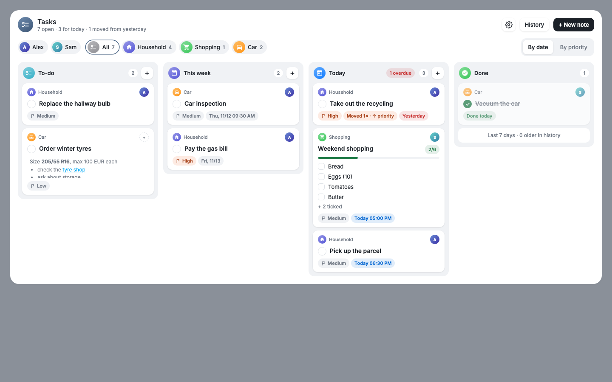
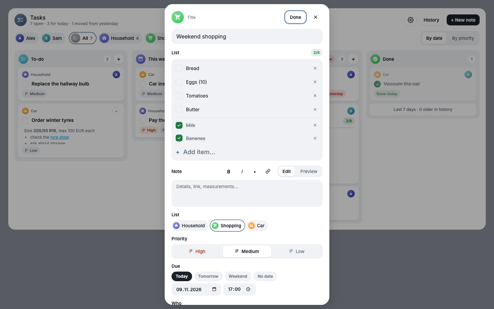
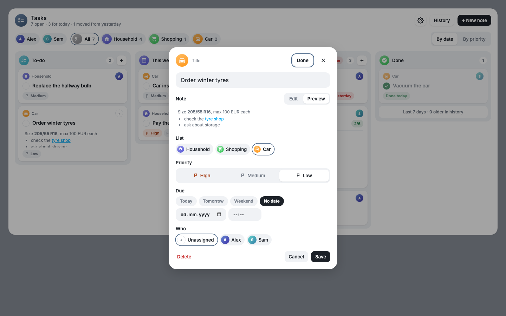
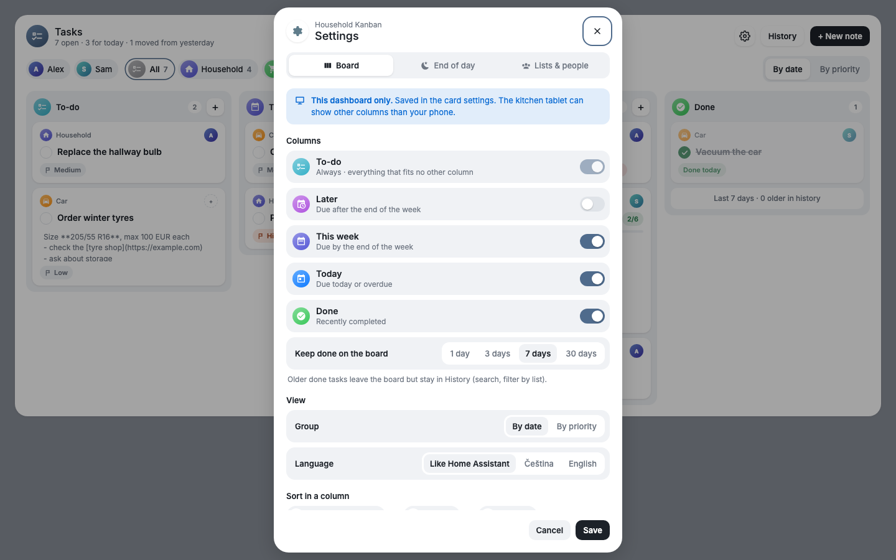
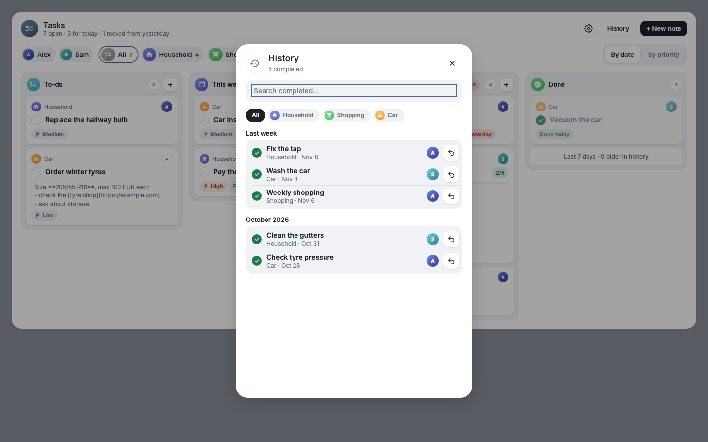
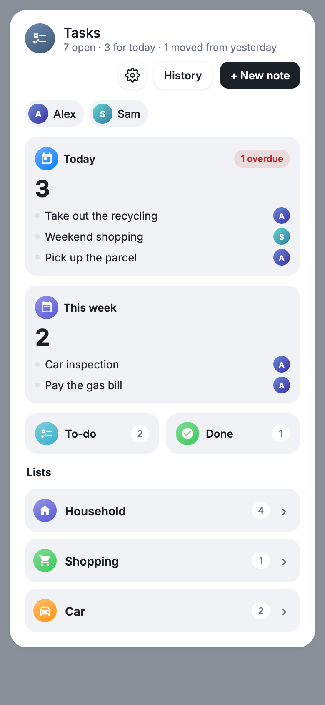
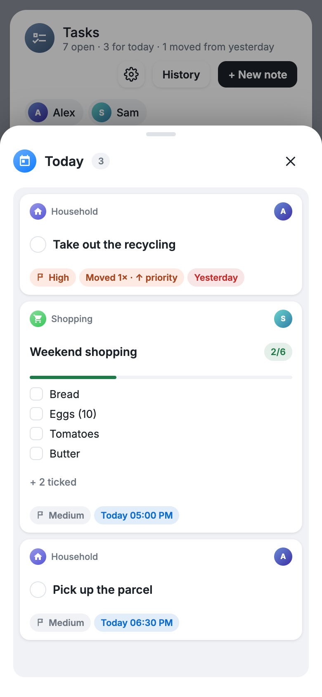

# Household Kanban

A shared household board for Home Assistant. Tasks live in ordinary `todo.*` entities (one per list, called a *parent*, e.g. *Household*, *Shopping*), so the HA app, Assist and automations keep working. The card shows them as a kanban board (To-do, This week, Today, Done) on wide screens and as tiles with a bottom sheet on phones. Priorities, assignees, an end-of-day rollover, a morning notification and a searchable history are included.



| Shopping list in one note | Formatted note | Settings from the board | History |
|---|---|---|---|
|  |  |  |  |

<p>


</p>

## Install

1. HACS → three dots → *Custom repositories* → `https://github.com/eMalinos/household-kanban`, category **Integration** (needed until it is in the HACS default list).
2. Download *Household Kanban*, restart Home Assistant.
3. Settings → Devices & services → Add integration → *Household Kanban*.

The integration serves the card itself, so no Lovelace resource is needed.

## Look

The card follows the Homecraft card style: it reads the `--hfb-*` theme variables (card, fill, accent, raised and primary buttons, segmented controls, soft panels). The Homecraft theme sets them, the Bento theme maps them, and under any other theme the card falls back to the standard Home Assistant colours. List colours stay the colour picked for each list.

## Options

Settings → Devices & services → Household Kanban → Configure.

- **End of day**: what happens at the close time to open items due that day or earlier.
  - `keep`: nothing changes.
  - `overdue`: items are shown in an extra *Overdue* column.
  - `move`: the due moves to the next day, same time.
  - `raise` (default): like `move`, and the priority goes up one step per day (Low → Medium → High).

  Close time defaults to `23:59`. A close missed while HA was offline runs once per missed day on startup.
- **Notifications** (off by default): a morning summary of what the end of day changed, with action buttons. Settings: on/off, time (default `08:00`), notify assignees on their own phone, and the notify services that receive unassigned items (and items of people without a phone).
- **Parents**: add, edit (name, icon, colour, shopping list: items go into one note) or remove a parent. Removing moves its items and history to another parent. *Household* always exists; it can be renamed, not removed.

A list marked *Shopping list* collects what Assist or the HA app adds as lines of the newest open shopping note (preferring one that already has lines), or of a new "Shopping" / "Nákup" note when none is open. Ticks are stored as `- [ ]` / `- [x]` lines at the end of the item description, so other to-do clients still see readable text. Notes support basic markdown: bold, italic, bullets and links.

Completed items stay in their entity for 30 days, then move to an archive; the History dialog searches both and never deletes.

## Card

```yaml
type: custom:household-kanban-card
columns: [todo, week, today, done]
done_days: 7
group: date
parents: [household, shopping]
people: [person.anna, person.tom]
```

The visual editor covers all options. Admins also get a gear button on the card: its Board and Lists & people tabs save these options straight into the dashboard (UI-managed dashboards only). The week ("This week", History) starts on the first weekday from the user's HA profile.

| Option | Default | Description |
| --- | --- | --- |
| `columns` | `[todo, week, today, done]` | Any of `todo`, `later`, `week`, `today`, `overdue`, `done`. `todo` is always on; `overdue` also appears automatically in `overdue` mode. |
| `done_days` | `7` | How long done items stay on the board: `1`, `3`, `7` or `30`. |
| `group` | `date` | Default grouping: `date` or `priority`. |
| `parents` | all | Parent IDs to show. |
| `people` | all `person.*` | People offered as assignees and filters. |
| `language` | HA language | `cs` or `en` to show the card in that language whatever Home Assistant uses. |

Unknown column ids make the card show a configuration error. Items sort by due date and time (no time = end of day), then priority, then age.

## Services and WebSocket

Services in the `household_kanban` domain: `create_item`, `update_item`, `set_status`, `delete_item` (see Developer tools → Actions for fields). Priority is `1` high, `2` medium (default), `3` low; `assignee` is a `person.*` entity ID.

WebSocket commands used by the card: `household_kanban/subscribe` (pushes the board on every change) and `household_kanban/history` (`search`, `parent`, `offset`, `limit`). Admin-only commands behind the card's settings dialog (gear button, admins only): `household_kanban/settings`, `household_kanban/settings/update`, `household_kanban/parents/add`, `household_kanban/parents/update` and `household_kanban/parents/remove` (`parent_id` identifies the list for update and remove).

## Event `household_kanban_day_closed`

Fired after each end-of-day run:

```yaml
run_id: "..."
day: "2026-11-01"
mode: raise          # keep | overdue | move | raise
items:               # items the run affected (values after the change)
  - uid: "..."
    summary: "Take out the bins"
    parent: household
    assignee: person.anna   # or null
    priority: 1
    due: "2026-11-02"       # date or datetime, or null
```

## Troubleshooting

- The card shows "Configuration error" right after install or update: hard-refresh the browser (or restart the app). The card is registered by the integration and may load after the dashboard.
- Nothing is loaded after a HACS update: restart Home Assistant so the new bundle is served.

## Development

```sh
uv venv --python 3.14 .venv
uv pip install --python .venv/bin/python -r requirements_test.txt
.venv/bin/pytest
.venv/bin/ruff check .
cd frontend && npm ci && npm run lint && npm test && npm run build
```

Local HA for manual checks: `docker compose -f dev/docker-compose.yml up` → http://localhost:8190.
